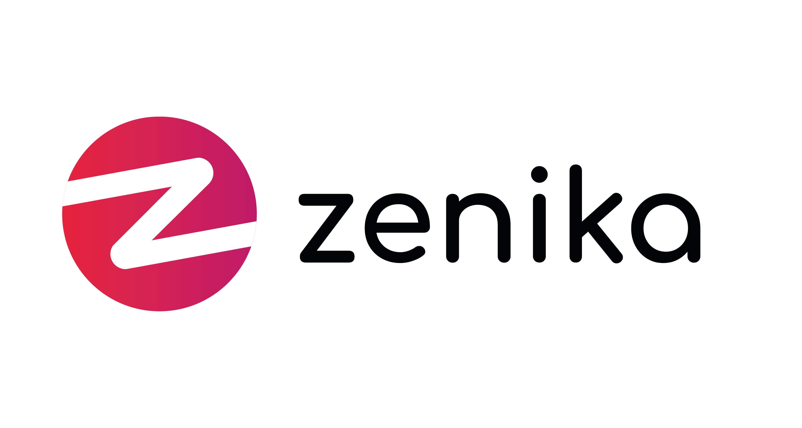
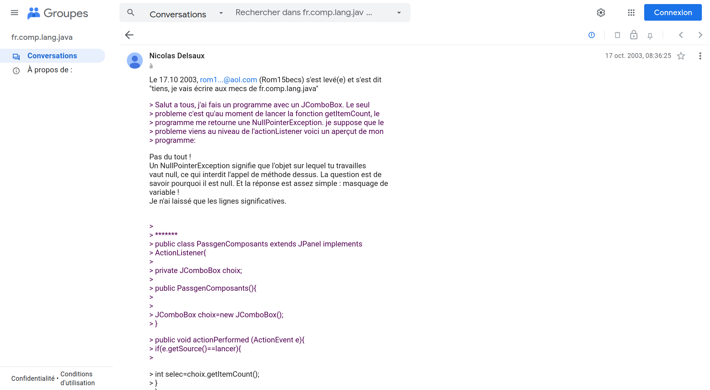
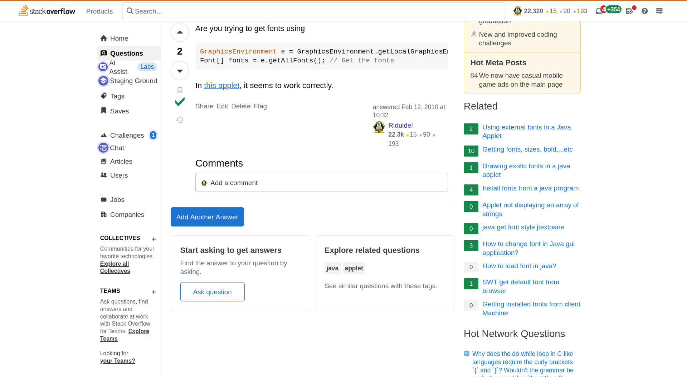
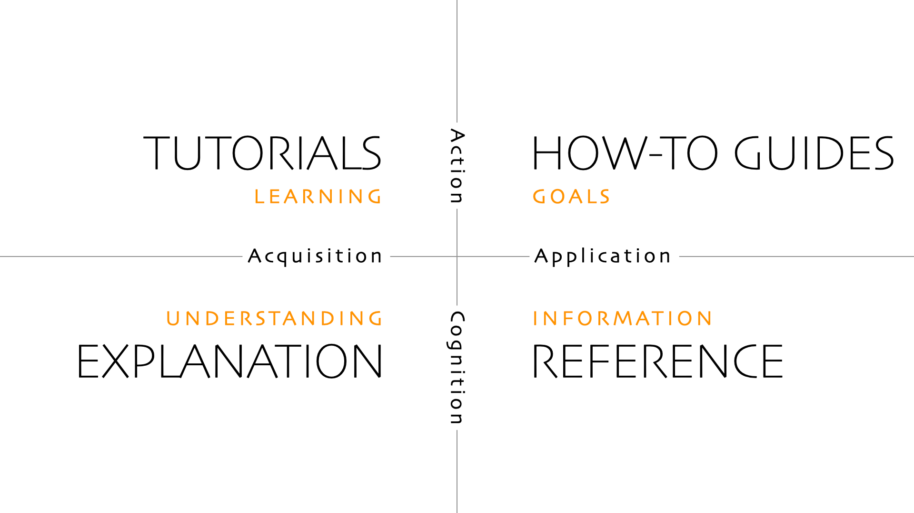
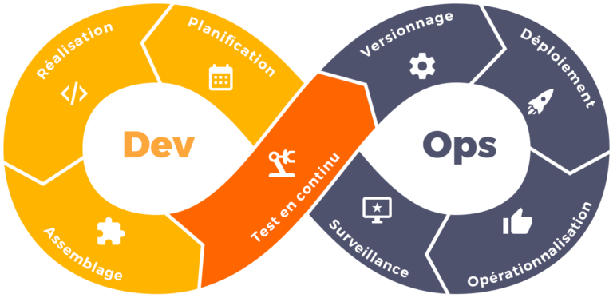
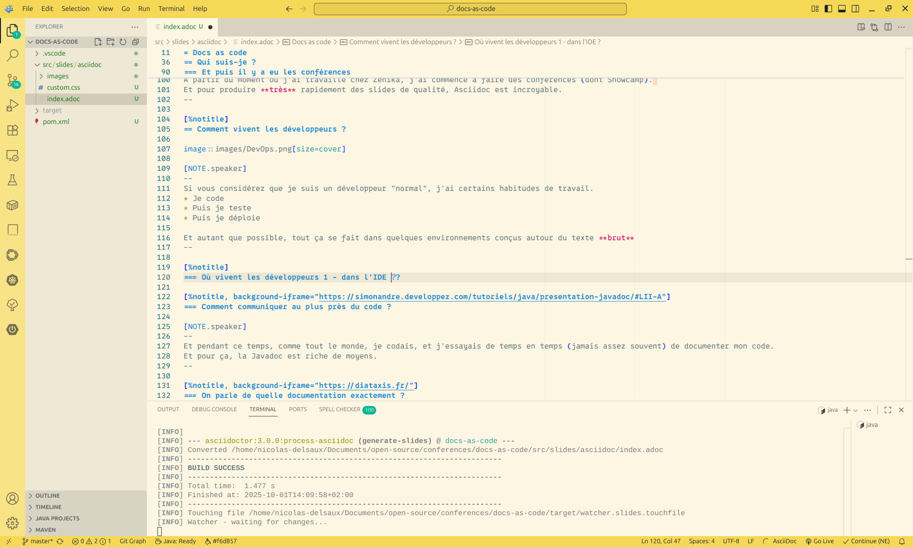
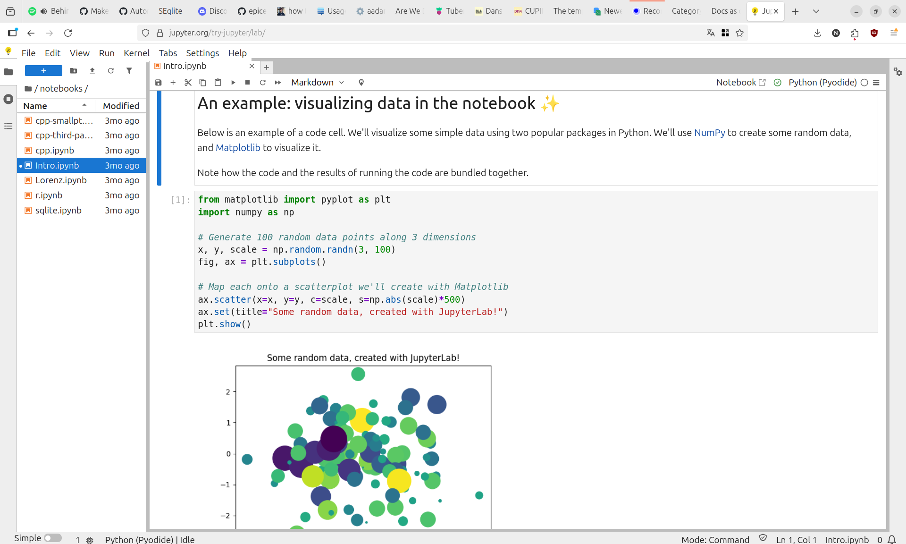
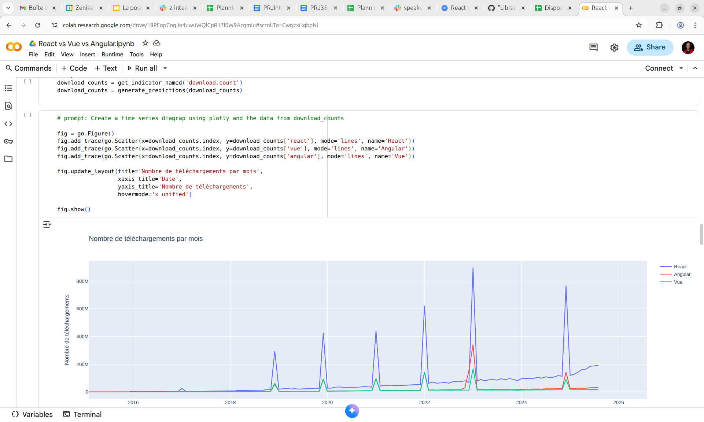

:icons: font
:revealjs_progress: true
:revealjs_previewLinks: true
:revealjs_mouseWheel: true
:revealjs_history: true
:revealjs_preloadIframes: true
:customcss: custom.css
:source-highlighter: highlightjs

[%notitle]
= Docs as code
:sectnums!:

[NOTE.speaker]
--
Checklist avant conférence

--

[%notitle, background-iframe="https://manifesteagile.fr/#valeurs"]
== Ca ne sert à rien, on est agiles

[NOTE.speaker]
--
Pourquoi documenter quand le manifeste agile dit clairement qu'il faut privilégier

[quote, https://manifesteagile.fr/#valeurs]
> Des solutions opérationnelles, de préférence à une documentation exhaustive

Précisément parce que le manifeste parle de privilégier, et pas d'éliminer.
Et dans cette présentation, on va précisément parler de moyens de produire plus de documentation avec moins de travail.
--

// tag::conference[]
[%notitle]
== Qui suis-je ?

La preuve ? La voila !

Nicolas Delsaux / https://stackexchange.com/users/8620[icon:stack-overflow[]] / https://www.linkedin.com/in/nicolasdelsaux/[icon:linkedin[]] / https://framapiaf.org/users/riduidel[@riduidel@framapiaf.org on 🐘]

Développeur Java depuis l'an 2000 - Architecte de solutions/systèmes depuis 2015
[%notitle]

[NOTE.speaker]
--
En tant que développeur et architecte, je me suis beaucoup intéressé à la question de la documentation en général.
--
// end::conference[]

=== Un peu d'histoire (personnelle)

[%notitle,background-iframe="http://nicolas.delsaux.free.fr/previous/via/technique/orga_via.html#heading_2.0.1"]
=== Avant le docs as code, il y a ... le docs as code !

[NOTE.speaker]
--
Ma première rencontre avec le docs as code date, comme pour beaucoup, de mes études.
Quand je vous dis ça, je suis sûr que vous pensez que j'ai démarré comme "tout le monde" avec LaTeX.
Eh bien non !

Parce que dans mon école d'ingénieur moderne, en 1997, on avait déja adopté XML.
Donc on créait nos documents en XML ... Ou plutôt en Docbook-XML.
--

[%notitle]
=== Comment communiquer dans un format très proche du texte brut ?

[NOTE.speaker]
--
Au début de ma carrière, pour trouver des réponses, il fallait aller sur ExpertsExchange ou sur Usenet (bien mieux).
Mais comment écrire du code qui apparaisse comme du code ?
Et comment enrichir le texte brut avec du gras ? de l'italique ? Du soulignement ?
--

[%notitle]
=== Comment écrire un texte facilement échangeable et diffusable sur le web ?

[NOTE.speaker]
--
Et comme l'entraide m'intéressait toujours, quand StackOverflow a été créé, j'ai obtenu un compte et j'ai commencé à y collaborer.
--

[%notitle]
=== Et puis il y a eu les conférences

[source,asciidoc]
----
include::index.adoc[tag=conference]
----

[%notitle]
== On parle de quelle documentation exactement ?

[%notitle]
=== Dans les méthodes de développement traditionnelles ?

image::https://www.datocms-assets.com/17507/1606815548-cycleenv.png[size=cover]

[%notitle]
=== Quels auteurs ? Quels outils ? Quelle communication ?

[cols="3*", options="header"]
|==========================
| Document | Auteur | Outil
| Spécification fonctionnelle | Experts fonctionnels | Document Word sur SharePoint
| Conception/architecture | Equipe d'architecture | OPEX / Document Word sur SharePoint
|==========================

[NOTE.speaker]
--
WARNING: On le remplit en live!
--

[%notitle]
=== Dans les méthodes dites agiles ?

image::https://blog.myagilepartner.fr/wp-content/uploads/2017/01/scrum2-0.png[size=cover]

[%notitle]
=== Quels auteurs ? Quels outils ? Quelle communication ?

[cols="3*", options="header"]
|==========================
| Document | Auteur | Outil
| User Story | PO | JIRA
| Cadrage technique | Tech lead | JIRA
|==========================

[NOTE.speaker]
--
WARNING: On le remplit en live!
--

[%notitle]
=== Avantages et inconvénients (des méthodes de documentation)

[cols="3*", options="header", frame=none, grid=none]
|==========================
|  | Cycle en V | Méthode agile
| Traçables ? | icon:times-circle[role=red] | icon:check-circle[role=green]
| Complètes ? | icon:check-circle[role=green] | icon:times-circle[role=red]
| Avec tests ? | icon:times-circle[role=red] | icon:times-circle[role=red]
| Cycle de vie aligné avec le code ? | icon:times-circle[role=red] | icon:times-circle[role=red]
|==========================

[%notitle, background-iframe="https://fr.wikipedia.org/wiki/Roue_de_Deming"]
=== Parenthèse qualité - roue de Deming

[%notitle, background-iframe="https://fr.wikipedia.org/wiki/Boucle_OODA"]
=== Parenthèse OODA - Version simple

[NOTE.speaker]
--
--

[%notitle]
=== Parenthèse OODA - Version complète

[pikchr, ooda_full, svg, opts=inline, role=svg]
----
include::ooda_full.pikchr[]
----

[%notitle]
== Comment vivent les développeurs ?

[NOTE.speaker]
--
Si vous considérez que je suis un développeur "normal", j'ai certains habitudes de travail.
* Je code
* Puis je teste
* Puis je déploie

Et autant que possible, tout ça se fait dans quelques environnements conçus autour du texte **brut**
--

[%notitle, background-iframe="https://survey.stackoverflow.co/2025/technology/#1-dev-id-es"]
=== Où vivent les développeurs 1 - dans l'IDE - 1?

// image::images/vscode.png[size=cover]

[NOTE.speaker]
--
Le premier auquel on pense, c'est évidement l'IDE.
--

[%notitle]
=== Où vivent les développeurs 1 - dans l'IDE - 2?

[NOTE.speaker]
--
Et dans l'IDE, évidement, on manipule de l'Unicode - voire de l'ASCII.
Mais surtout, on manipule du texte brut. 
Il n'y a pas de WYSIWYG mais au contraire du texte brut qui sera compilé en programme (ou en document).
--

[%notitle, background-iframe="https://survey.stackoverflow.co/2025/technology/#1-code-documentation-and-collaboration-tools"]
=== Où vivent les développeurs 1 - dans les outils de communication ?

[NOTE.speaker]
--
Immédiatement après, il y a les outils de collaboration, dont font bien sûr partie les gestionnaires de source.

IMPORTANT: Notez bien qu'à la quatrième ligne, on parle de Markdown **avant** de parler de Confluence.

On peut aussi remarquer un certain nombre d'outils qui tombent dans la banette du docs as code

* Jira
* Markdown
* Confluence
* Obsidian
* Wikis
* Google Colab
* Redmine
* Youtrack
--

[%notitle, background-iframe="https://www.cloudbees.com/blog/what-is-everything-as-code-eac"]
=== *-as-code

[NOTE.speaker]
--
Non c'est une blague
--

== Une définition de docs as code ?

Un ensemble d'outils qui permet d'aligner la production de documents avec la production de code

* Contenu versionnable (et versionné!)
* Documents produits par l'intégration continue
* Un modèle, plusieurs vues (web, pdf, ...)

== Quelques implémentations populaires

[%notitle, background-iframe="https://fr.wikipedia.org/wiki/LaTeX#Exemple"]
=== LaTeX

[NOTE.speaker]
--
Standard dans le monde académique, il souffre d'un visuel vieillot.
--

[%notitle, background-iframe="https://fr.wikipedia.org/wiki/Markdown#Exemples_de_la_syntaxe"]
=== Markdown

[NOTE.speaker]
--
Beaucoup plus utilisé chez les développeurs, il n'est pas standardisé
--

[.columns]
=== Markdown, mais lequel ?

[.column]
* Markdown (original)
* Multi-markdown
* CommonMark (Discourse, StackExchange, Reddit)
* GitHub Flavored Markdown (GitHub)

[.column]
* MultiMarkdown
* Markdown Extra
* CriticMarkup
* StrictDown

[NOTE.speaker]
--
Liste trouvée sur https://github.com/rhythmus/markdown-resources/blob/master/markdown-dialects.yml[markdown-resources]
--

[%notitle, background-iframe="https://www.ericholscher.com/blog/2016/mar/15/dont-use-markdown-for-technical-docs/"]
=== Ca va loin !

[%notitle, background-iframe="https://scribe.rip/@wetrocloud/why-markdown-is-the-best-format-for-llms-aa0514a409a7"]
=== Markdown pour les LLM

=== Comment l'intégrer dans son développement ?

* Intégré dans VSCode
* https://github.com/walokra/markdown-page-generator-plugin?tab=readme-ov-file[markdown-page-generator-plugin]
** https://github.com/vsch/flexmark-java[flexmark-java]
* https://www.npmjs.com/search?q=keywords:markdown[NPM]: marked, micromark, (plus de 500 packages le mentionnent)

[%notitle, background-iframe="https://fr.wikipedia.org/wiki/AsciiDoc#Exemple"]
=== Asciidoc

[%notitle, background-iframe="https://www.slant.co/versus/1903/23065/~markdown_vs_asciidoc"]
=== Mais pourquoi ?

[NOTE.speaker]
--
* Support des includes
* (faibles) capacités de macros
* Plus facilement extensible
--

=== Comment l'intégrer dans son développement ?

* Intégré dans VSCode
* https://docs.asciidoctor.org/maven-tools/latest/[asciidoctor-maven-plugin]
* https://docs.asciidoctor.org/asciidoctor.js/latest/[asciidoctor.js]

////
[%notitle, background-iframe="https://fr.wikipedia.org/wiki/ReStructuredText?useskin=vector#Quelques_exemples"]
=== ReStructured

[%notitle, background-iframe="https://typst.app/"]
=== Typst
////

== Aller plus loin

[%notitle, background-iframe="https://pandoc.org/"]
=== Pandoc

[%notitle, background-iframe="https://en.wikipedia.org/wiki/Literate_programming?useskin=vector#Program_as_a_web"]
=== La programmation littéraire

[%notitle, background-iframe="https://en.wikipedia.org/w/index.php?title=Web_(programming_system)&useskin=vector#CWEB"]
=== CWeb

[%notitle, background-iframe="https://mystmd.org/"]
=== Myst

[%notitle]
=== Jupyter Notebboks

[%notitle]
=== Google Colab

[%notitle, background-iframe="https://blog.atuin.sh/atuin-desktop-open-source/"]
=== Atuin Runbook

=== Le diagram as code ?

[%notitle, background-iframe="https://graphviz.org/"]
=== GraphViz

[%notitle, background-iframe="https://plantuml.com/fr/"]
=== PlantUML

[%notitle, background-iframe="https://mermaid.js.org/"]
=== Mermaid

[%notitle, background-iframe="https://pikchr.org/home/doc/trunk/homepage.md"]
=== Pikchr

[%notitle, background-iframe="https://kroki.io/"]
=== Kroki

[%notitle, background-iframe="https://docs.structurizr.com/"]
=== L'architecture as code ?

== Conclusion

* Aligne la production de documentation avec le code 👍🏻
* Appliquer les méthodes de production de code (qualité, versionning) à la doc 👍🏻
* Aligne l'organisation sur les développeurs 👎🏻
* Augmente la barrière d'entrée 👎🏻

== Merci !

image::https://media.giphy.com/media/1sMH6m5alWauk/giphy.gif[width=200%]