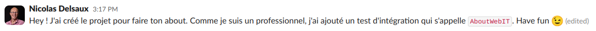

:icons: font
:revealjs_progress: true
:revealjs_previewLinks: true
:revealjs_mouseWheel: true
:revealjs_history: true
:revealjs_preloadIframes: true
:revealjs_plugin_notes: enabled
:customcss: custom.css
:source-highlighter: highlightjs
:city: lille

[%notitle]
= Maven, tu crois que tu connais ?
:sectnums!:

[NOTE.speaker]
--
Checklist avant conférence

--

// [%notitle, background-image="https://maven.apache.org/images/branding/im_a_grateful_maven_user_1.png"]
// == Qui suis-je ?
// 
// Nicolas Delsaux / https://stackexchange.com/users/8620[icon:stack-overflow[]] / https://www.linkedin.com/in/nicolasdelsaux/[icon:linkedin[]] / https://framapiaf.org/users/riduidel[@riduidel@framapiaf.org on 🐘]
// 
// Développeur Java depuis l'an 2000
// 
// Architecte de solutions/systèmes depuis 2015
// 
// image::images/zenika.png[height=100]
// 
// [NOTE.speaker]
// --
// En tant que développeur et architecte, je me suis beaucoup intéressé à la question de la documentation d'architecture.
// --

== Maven, c'est quoi?

// TODO: Maven est une vieille techno, apportant des avantages uniques

[%notitle, background-iframe="https://earthly.dev/blog/brown-green-language/"]
=== Avant tout, c'est une vieille techno

[%notitle, transition=none]
=== C'est un orchestrateur de plugins

[pikchr, png]
....
include::lifecycle_default.pikchr[]
....

[%notitle, transition=none]
=== C'est un orchestrateur de plugins - dépendant du type de livrable

[pikchr, png]
....
include::lifecycle_jar.pikchr[]
....

[%notitle, background-iframe="https://maven.apache.org/guides/introduction/introduction-to-dependency-mechanism.html"]
=== Et un gestionnaire de dépendances

[%notitle, background-iframe="https://speakerdeck.com/mcfunley/choose-boring-technology"]
=== Mais c'est surtout une technologie chiante

== Comment en parler ?

=== Une belle page about ?

[source,javascript]
----
{
    "version": "1.0.0-SNAPSHOT",
    "branch": "myBranch",
    "commit": "4H45H"
}
----

[NOTE.speaker]
--
On va prendre un exemple simple : 
mettre le numéro de version de maven (et ensuite le commit git)
dans notre application pour l'afficher. 
Le cas d'utilisation le plus typique est celui d'une application web avec une page /about
alors allons-y, codons rapidement cette application!

Pour démarrer, ouvrir le dossier exemple, et lancer la commande
--

[%notitle, background-iframe="https://javalin.io/"]
=== Petite parenthèse : Javalin

[%notitle]
=== Démarrage de la démo - 1 - filtrage de ressource et getResource!

// image::https://media.giphy.com/media/Y1XrxoBKZHTHeky1Wy/giphy.gif[]

[NOTE.speaker]
--
Donc on va dans le dossier example,
on présente le projet,
on ajoute les différents plugins marrants,
on arrive à l'étape du test qui échoue, et on l'implémente avec la gestion de ressources.
--

[%notitle, background-iframe="https://maven.apache.org/plugins/maven-resources-plugin/examples/filter.html"]
=== Explication de la démo - 1 - filtrage de ressource et getResource!

[%notitle, background-iframe="https://www.mojohaus.org/buildnumber-maven-plugin/"]
=== Démo 2 - Ajouter la branche et le commit

== Aller plus loin

[%step]
* Maven - boring as a service
* Il y a souvent un plugin (voir par exemple sur https://mvnrepository.com/open-source/maven-plugins[mvnrepository])
* Et sinon
** https://maven.apache.org/plugins/maven-antrun-plugin/[maven-antrun-plugin]
** Groovy (avec https://github.com/groovy/GMavenPlus[GMavenPlus])
** Votre propre plugin

== Merci !

image::https://media.giphy.com/media/1sMH6m5alWauk/giphy.gif[width=200%]

[.columns]
== Références

* https://maven.apache.org/guides/introduction/introduction-to-the-lifecycle.html#lifecycle-reference[Maven build lifecycle]
* https://github.com/andirady/pom-cli/[pom-cli]
* https://github.com/diffplug/spotless/tree/main/plugin-maven[spotless-maven-plugin] et https://github.com/Ekryd/sortpom[sortpom-maven-plugin]
* https://github.com/fabriciorby/maven-surefire-junit5-tree-reporter[maven-surefire-junit5-tree-reporter]
* https://github.com/khmarbaise/maven-buildtime-profiler[maven-buildtime-profiler]

// === Si vous voulez les slides
// 
// image::images/url_github.com.png[]

